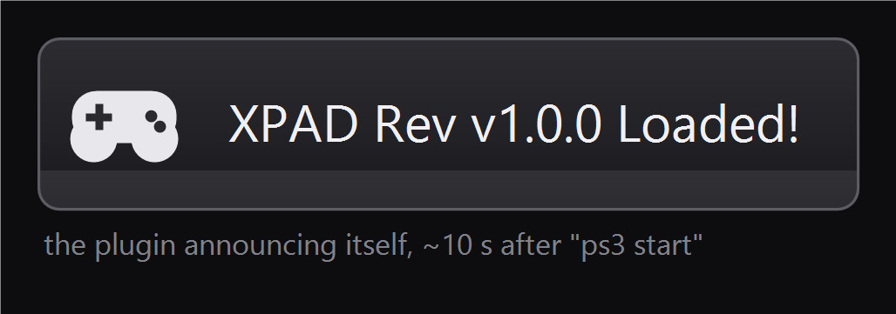
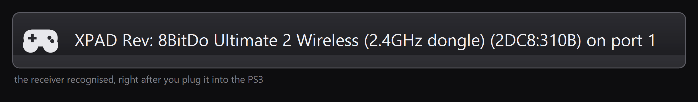
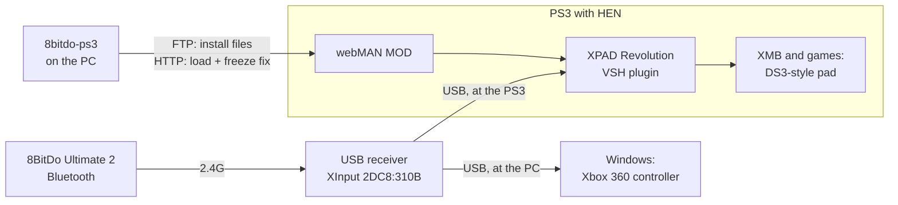

# 8BitDo Ultimate 2 Bluetooth on PS3

[](LICENSE)


Use the **8BitDo Ultimate 2 Bluetooth** controller, with its 2.4G USB receiver, as a controller on
a **PS3 running HEN**. The same receiver keeps working on your **Windows PC**.

The PS3 can't use this controller out of the box. It has no driver for Xbox-style (XInput) devices,
which is what the 8BitDo receiver presents. This project installs and starts the
[XPAD Revolution](https://github.com/GabaRSk/XPAD-Revolution) plugin, which adds that driver, from
your PC over the network. While starting it, it fixes the XMB freeze that the plugin otherwise
causes on PS3HEN. It is a small command-line tool: one command to install, one command each time
you turn the PS3 on.

> **Status:** works on the author's console (CEX 4.92, PS3HEN 3.4.0, webMAN MOD 1.47.48n,
> receiver firmware 1.03). Other setups are untested. Reports are welcome, see [Contributing](#contributing).

## Contents

- [What you get](#what-you-get)
- [Requirements](#requirements)
- [What this changes on your PS3](#what-this-changes-on-your-ps3)
- [Install (one time)](#install-one-time)
- [Every time you play](#every-time-you-play)
- [Switching between the PS3 and the PC](#switching-between-the-ps3-and-the-pc)
- [Commands](#commands)
- [Troubleshooting](#troubleshooting)
- [Uninstall](#uninstall)
- [How it works](#how-it-works)
- [Local test environment](#local-test-environment)
- [Roadmap](#roadmap)
- [Contributing](#contributing)
- [Credits](#credits)
- [License](#license)

## What you get

| DualShock 3 feature | With the 8BitDo on the PS3 |
|---|---|
| Buttons, D-pad, Start, Select, L3/R3 | ✅ positional: the bottom face button is Cross, the right one is Circle, whatever the labels say |
| PS button | ✅ the Home button (opens the XMB menu) |
| Analog sticks | ✅ with a DS3-like response curve (adjustable in `xpad_analog.txt`) |
| L2 / R2 analog | ✅ full 0–255 range |
| Pressure-sensitive face buttons | ⚠️ on or off only (0 or 255); the 8BitDo face buttons are digital |
| Rumble | ❌ **do not use the SELECT + L3 + R3 shortcut.** It loads XPAD's in-game module, and on the tested console (PS3HEN 3.4.0) that **hangs the PS3**. Rumble works normally while the receiver is on the PC. See [Roadmap](#roadmap) |
| Sixaxis motion | ❌ games see a still controller. The controller has a motion sensor, but 8BitDo only enables it for the Switch: the receiver's XInput mode carries no motion data, and XPAD has no motion support for any controller. See [Roadmap](#roadmap) |
| Extra buttons (L4/R4, back paddles) | ➖ map them to other buttons on the controller itself (see 8BitDo's manual) |

**PC:** nothing changes. Windows keeps seeing an Xbox 360 controller, and the receiver itself is
never modified.

**Bluetooth straight to the PS3** does not work: the PS3 only pairs its own controllers over
Bluetooth. Use the 2.4G receiver.

## Requirements

**Controller**
- 8BitDo **Ultimate 2 Bluetooth** with its **2.4G USB receiver** (tested).
- XPAD names this receiver's USB ID (`2DC8:310B`) "8BitDo Ultimate 2 Wireless (2.4GHz dongle)", so
  other 8BitDo controllers whose receiver shows up with that ID probably work the same. They are
  untested.

**PS3**
- **HEN** enabled (tested: PS3HEN 3.4.0 on 4.92 CEX). Untested on CFW (Cobra).
- **[webMAN MOD](https://github.com/aldostools/webMAN-MOD)** installed and loaded by HEN (tested:
  1.47.48n). It provides the FTP and web servers this tool talks to. HEN setups usually include it.
- Connected to the **same network** as your PC (Wi-Fi or cable).

**PC**
- **Windows 10 or 11.**
- **[Python](https://www.python.org/downloads/) 3.10 or newer** (tested with 3.12). Tick
  *"Add python.exe to PATH"* in the installer.
- [Git](https://git-scm.com/download/win) (optional; you can download the ZIP instead).

## What this changes on your PS3

- **Writes:** the five XPAD Revolution files, copied to `/dev_hdd0/plugins/ps3xpad/`.
  - If an older copy is there, it is saved first under `backups/` on your PC.
- **Never adds anything to `boot_plugins.txt`.** With XPAD in that file, "Enable HEN" hangs on PS3HEN
  (details in [How it works](docs/HOW_IT_WORKS.md#why-not-boot_pluginstxt)). If XPAD is already
  listed there, `install` removes that one line (after a backup) and keeps the rest of the file.
- **The freeze fix is applied in memory only.** It is a one-instruction change in the running plugin,
  checked byte by byte before it is written. Restarting the PS3 removes it, and no plugin file is
  modified.
- **`/dev_hdd0/autoexec.bat`** gets a marked block (`install` turns this on; `--no-autorun` skips
  it). It is how the PS3 starts the plugin by itself, without a PC. Anything else already in that
  file is kept, and `ps3 autorun --off` removes only our block.
- **Where the plugin files come from:** XPAD Revolution's own GitHub repository, at a pinned
  commit, checked against SHA-256 hashes before anything is sent to the PS3. They are not included
  here.
  - Microsoft Defender flags XPAD's *release zip*, so it is not used. The files from the git tree
    were decrypted and audited instead ([audit](docs/HOW_IT_WORKS.md#audit-of-the-plugin-files)).

As with any homebrew: keep a backup of anything you care about on the PS3, and read
[Troubleshooting](#troubleshooting) before you start.

## Install (one time)

**1. Get the code.** Open *PowerShell* or *Command Prompt*:

```powershell
git clone https://github.com/jravolio/8bitdo-ultimate2-ps3.git
cd 8bitdo-ultimate2-ps3
```

No Git? Click **Code → Download ZIP** on this page, unzip it, then open a terminal in that folder.
In File Explorer you can click the address bar, type `powershell` and press Enter.

**2. Set it up.** This creates a private Python environment in the folder (`.venv`):

```powershell
.\setup.cmd
```

**3. Turn the PS3 on and enable HEN.** Wait until you are back on the XMB and webMAN has shown
its welcome message.

**4. Find the PS3 on your network:**

```powershell
.\8bitdo-ps3 ps3 find
```
```text
192.168.1.50: 220 webMANftpd 1.47.48n MOD [NTFS:0]
```

The address is remembered for later. If nothing is found, check that the PS3 and the PC are on the
same network. You can also give the address yourself: webMAN shows it, or use *Settings → Network
Settings → Settings and Connection Status List*. Add `--host 192.168.1.50` to any command.

**5. Install the plugin on the PS3:**

```powershell
.\8bitdo-ps3 ps3 install
```
```text
XPAD Revolution @ 0592973: checking the files (SHA-256 pinned)
  downloading xpad_vsh_autodiscovery.sprx from https://github.com/GabaRSk/XPAD-Revolution @ 0592973
  ...
copying to 192.168.1.50:
  ok  /dev_hdd0/plugins/ps3xpad/xpad_vsh_autodiscovery.sprx (30343 bytes)
  ok  /dev_hdd0/plugins/ps3xpad/xpad_game.sprx (7731 bytes)
  ...
turning on the on-console auto-start:
  ok  /dev_hdd0/autoexec.bat (on-console auto-start written)
installed: the PS3 now starts XPAD and the freeze fix by itself after every "Enable HEN"
(no PC needed, nothing added to boot_plugins.txt; `8bitdo-ps3 ps3 autorun --off` undoes it)
```

That's the whole installation. From now on the PS3 starts the plugin on its own; below is what you
will see.

## Every time you play

The plugin has to be started after each **"Enable HEN"**. HEN itself has to be re-enabled after
every restart too. `install` already made the PS3 do all of that by itself, so normally you never
touch the PC again.

*The notification pictures below are renderings of the plugin's real on-screen messages, so you know
what to look for. The text is exactly what the PS3 shows; they are not photographs of a TV.*

1. **Turn the PS3 on and enable HEN.** Wait for the XMB. About 15 seconds later the PS3 shows:

   
2. **Plug the 8BitDo receiver into a PS3 USB port** and turn the controller on (press Home). The PS3
   shows:

   

   - It takes the next free controller port. To make it player 1, turn the DualShock 3 off first:
     hold PS, then choose *Turn Off Controller*.
3. **Play.** Do **not** hold SELECT + L3 + R3 on the 8BitDo: on PS3HEN that loads XPAD's in-game
   module and hangs the console (details in [Roadmap](#roadmap)). Rumble works on the PC instead.

That is it — the console loaded the plugin and the freeze fix on its own, and the PC can stay off.
`.\8bitdo-ps3 status` shows the mode (`on-console auto-start: ON`). `ps3 autorun --off` turns it
back off, and `ps3 autorun` turns it on again.

**Prefer to start it from the PC?** Turn the on-console start off once, then use `ps3 start` (or
keep `ps3 watch` running and it notices each time HEN comes up):

```powershell
.\8bitdo-ps3 ps3 autorun --off
.\8bitdo-ps3 ps3 start
```
```text
PS3MAPI via HTTP
asked webMAN to load XPAD
libpad polling disabled at 0xa48a38 (module 0x230b3117, segment base 0xa40000, read back 480002c4)
XPAD is running with the freeze fix. Plug the receiver into the PS3 and turn the controller on.
```

```powershell
.\8bitdo-ps3 ps3 watch
```
```text
watching for the PS3; XPAD is started each time HEN is enabled. Ctrl+C to stop.
[20:14:03] webMAN is up on 192.168.1.50 (HEN enabled)
...
[20:14:21] XPAD running: plug in the receiver and turn the controller on
```

## Switching between the PS3 and the PC

The receiver works the same way on both, so **switching just means plugging it into the other
machine**. Nothing needs to be turned on or off. Two shortcuts:

```powershell
.\8bitdo-ps3 use ps3    # install if needed, then start the plugin on the PS3
.\8bitdo-ps3 use pc     # check that Windows sees the controller
```

`.\8bitdo-ps3 status` shows both sides at once:

```text
8BitDo receiver (this PC)
  linked, XInput mode (2DC8:310B) = what both the PC and the PS3 plugin use
PC (Windows XInput)
  slot 1 connected
DualShock 3 (this PC)
  not connected to this PC
PS3
  192.168.1.50: XPAD files installed
  XPAD running, freeze fix applied
```

## Commands

Run them from the project folder as `.\8bitdo-ps3 <command>`. That works in both PowerShell and
Command Prompt. Add `--host <PS3 IP>` to any PS3 command to skip the network search.

| Command | What it does |
|---|---|
| `status` | Receiver, PC, DualShock 3 and PS3 at a glance |
| `use ps3` / `use pc` | Switch helpers (see above) |
| `ps3 find` | Find the PS3 on the local network and remember its address |
| `ps3 install` | Download and verify XPAD Revolution, copy it to the PS3, turn on the on-console auto-start (`--no-autorun` skips it) |
| `ps3 start` | Start the plugin with the freeze fix (after every "Enable HEN") |
| `ps3 autorun` | Turn the on-console auto-start on or off: after every "Enable HEN" the PS3 starts the plugin + freeze fix by itself, no PC (`--off` to remove; on by default after `install`) |
| `ps3 watch` | Keep running and do `ps3 start` by itself after every boot (`--minutes N` to stop after N minutes) |
| `ps3 status` | Details: files on the PS3, `boot_plugins.txt`, whether the plugin is running and patched |
| `ps3 log` | Download the plugin's own log and explain it in plain words |
| `ps3 live` | Show what the PS3 plugin is reading from the controller, live. `--walkthrough` asks you to press every button and confirms each one |
| `ps3 uninstall` | Remove the plugin files from the PS3 |
| `ps3 restore` | Remove XPAD from every `boot_plugins.txt` (for a PS3 that hangs on "Enable HEN"). `--wait` keeps trying until the PS3 answers |
| `recovery-stick` | Prepare a USB stick that makes HEN load only webMAN (see Troubleshooting) |
| `pc-test` | Live view of what Windows games receive, plus a short rumble pulse |
| `rumble-check` | Pulse both motors and require the receiver's ACK for every packet (`--pulses`, `--duration-ms`, `--strength`, `--wait`) |
| `test` | Run the simulated PS3 (developers, see [Local test environment](#local-test-environment)) |

## Troubleshooting

**`ps3 find` finds nothing**
- Is HEN enabled? webMAN only runs after "Enable HEN".
- Are the PS3 and the PC on the same network?
- Try `--host <IP>` with the address from the PS3's network settings.
- The address can change after a restart (DHCP). `ps3 find` again, or reserve an address for the
  PS3 in your router.

**"XPAD Rev ... Loaded!" appeared, but the controller does nothing**
- Turn the controller on *after* the receiver is plugged into the PS3 (press Home), and use the
  2.4G receiver, not Bluetooth.
- Run `.\8bitdo-ps3 ps3 log`. It tells you what the plugin saw, for example:
  - `the receiver was seen idle (2DC8:3109)`: the controller is off or not linked. Press Home.
  - `presented itself as a Switch Pro Controller (057E:2009)`: unplug the receiver, turn the
    controller off, plug the receiver back in, then turn the controller on.
- `.\8bitdo-ps3 ps3 live` shows live input as the plugin reads it.

**`ps3 start` says "NOT patching" or "freeze fix could NOT be applied"**
- The plugin running on the PS3 is not the expected build, so nothing was written. Run
  `ps3 install` (it puts the pinned build back), **restart the PS3**, enable HEN, then `ps3 start`.
- Don't keep using a session where the fix wasn't applied; the XMB can freeze a couple of minutes later.

**The XMB froze**
- Hold the PS3's power button for about 10 seconds until it turns off, then turn it on again. The
  PS3 may say it was not turned off properly and check the file system. That is normal; let it finish.
- Then enable HEN and run `ps3 start` again. If it keeps happening, open an issue and attach the
  output of `ps3 log` and the newest `captures/ps3_start_*.json`.

**"Enable HEN" hangs, or the console gets stuck while enabling HEN**

This happens when a boot plugin misbehaves, for example XPAD added to `boot_plugins.txt` by hand.
This tool never does that. In order of effort:
1. Force the PS3 off (hold power ~10 s). Turn it on, then **hold R2 while enabling HEN**. HEN then
   skips all boot plugins for that boot.
2. **Recovery stick:** HEN reads `boot_plugins.txt` from a USB stick before the internal drive.
   1. Plug a FAT32 USB stick into the PC and run `.\8bitdo-ps3 recovery-stick`. It writes a
      `boot_plugins.txt` that loads only webMAN, and keeps any existing one as `.bak`.
   2. Plug the stick into the PS3 and enable HEN. webMAN starts, and nothing else. HEN only checks
      the first two USB devices (`/dev_usb000`, `/dev_usb001`), so if your other plugins still
      load, try another USB port.
3. With webMAN up, run `.\8bitdo-ps3 ps3 restore`. It removes XPAD from `boot_plugins.txt` and keeps
   everything else. Then take the stick out and restart. You can also start `ps3 restore --wait`
   first: it keeps trying and acts as soon as the PS3 answers.

**The DualShock 3 blinks red fast when plugged into the PC**
- That is normal: only a PS3 (or a special driver) tells it which player number to show.

## Uninstall

```powershell
.\8bitdo-ps3 ps3 uninstall
```

This removes the plugin files from the PS3. A copy that is already running stays until the next
restart. On the PC, delete the project folder.

## How it works



- XPAD Revolution adds a USB driver for the receiver and turns its XInput reports into a standard
  PS3 controller that the XMB and games can use.
- Loading it from `boot_plugins.txt` hangs "Enable HEN" on PS3HEN, so `ps3 start` has webMAN load it
  once the XMB is up.
- Once loaded, the plugin polled every controller port from inside the system software every 10 ms.
  That froze the XMB after about two minutes. `ps3 start` turns that poll off with a single checked
  branch change in memory. The 8BitDo input doesn't depend on that poll.

Full explanation, the exact requests, and the audit: **[docs/HOW_IT_WORKS.md](docs/HOW_IT_WORKS.md)**.

## Local test environment

To develop or test without the console, `sim/` runs **XPAD Revolution's real, unmodified source**
as a simulated PS3:
- It is compiled for 32-bit big-endian PowerPC and runs under `qemu-ppc` in WSL.
- The PS3 system parts the plugin talks to (USB driver layer, pad layer, files, notifications) are
  replaced by small stand-ins.
- It is fed by a virtual receiver, or by your real one.

Setup (one time):
1. Install WSL with Ubuntu (`wsl --install -d Ubuntu`).
2. Turn on mirrored networking: put these two lines in `%UserProfile%\.wslconfig`, then run
   `wsl --shutdown`:
   ```ini
   [wsl2]
   networkingMode=mirrored
   ```
3. Install the toolchain: `wsl -d Ubuntu -- bash sim/setup_wsl.sh`
4. Install the test tools: `.\setup.cmd dev`

Run:

```powershell
.\8bitdo-ps3 test              # virtual receiver, fully automatic
.\8bitdo-ps3 test --with-ds3   # with a DualShock 3 already on port 1
.\8bitdo-ps3 test --real       # your real receiver (needs UsbDk); you press what it asks
.\8bitdo-ps3 test --unpatched  # the plugin without the freeze fix, for comparison
.venv\Scripts\python -m pytest # all tests: model, FTP install, freeze fix vs a fake webMAN, simulator
```

By default the simulator runs the plugin **with the freeze fix**, as `ps3 start` leaves it on the
console. The simulator build applies the fix at the matching source line, a check in XPAD's game
loader. The test then confirms three things:
- SELECT + L3 + R3 still loads the rumble module, through XPAD's own USB data;
- a game's rumble command reaches the receiver;
- XPAD no longer touches the system pad library, which is what froze the XMB.

On the first run, XPAD Revolution's source is cloned at the pinned commit into `refs/`, and the
simulator is built. Each run writes a report, the plugin's log, and a USB capture (`.pcap`, opens in
Wireshark) to `captures/sim_*/`.

## Roadmap

- [x] Start without a PC (`ps3 autorun`: a webMAN script in `/dev_hdd0/autoexec.bat`)
- [ ] **In-game rumble.** The simulator passes it, but on the tested console (PS3HEN 3.4.0) the
      SELECT + L3 + R3 shortcut loads XPAD's in-game module and hangs the PS3. Needs a HEN-safe way
      to load that module
- [ ] Reports from other firmware / HEN / webMAN versions and from Cobra CFW
- [ ] Wired (USB-C cable) mode: check which USB ID the controller uses and whether XPAD drives it
- [ ] **Motion (Sixaxis).** Needs two things that don't exist yet:
  1. a USB mode that carries the controller's motion data. Users report that a beta receiver
     firmware from 8BitDo support adds a Switch Pro Controller mode (SELECT + Y) with motion. That
     is unverified for this model, and this project doesn't flash firmware.
  2. a PS3 driver that reads Switch Pro Controller motion reports and fills in the DualShock 3
     motion fields. XPAD Revolution always sends a neutral value there.

## Contributing

Issues and pull requests are welcome, especially reports from other setups. Please include:
- PS3 firmware, HEN and webMAN versions;
- receiver firmware: plug the receiver into the PC with the controller off and run `.\8bitdo-ps3 status`;
- the output of `.\8bitdo-ps3 ps3 log`;
- the newest `captures/ps3_start_*.json`.

For code changes, run `.\setup.cmd dev`, then `.venv\Scripts\python -m pytest`. The simulator tests
run only when the WSL toolchain is installed; the rest run anywhere.

## Credits

- [XPAD Revolution](https://github.com/GabaRSk/XPAD-Revolution) by **GabaRSk**: the PS3 plugin that does
  the actual work. This project downloads, verifies, installs and starts it.
- **OsirisX**: the original [PS3xPAD](https://www.psx-place.com/resources/ps3xpad.22/), the
  foundation of XPAD Revolution.
- [webMAN MOD](https://github.com/aldostools/webMAN-MOD) by **aldostools**: FTP, web server and
  PS3MAPI, which make remote install and start possible.
- [PS3HEN](https://github.com/PS3Xploit/PS3HEN) by the **PS3Xploit** team.
- [RPCS3](https://rpcs3.net/) (decrypting the plugins for the audit), [REA](https://github.com/morluto/rea),
  [rizin](https://rizin.re/), [Ghidra](https://ghidra-sre.org/), [ILSpy](https://github.com/icsharpcode/ILSpy)
  and [PSL1GHT](https://github.com/ps3dev/PSL1GHT) (reverse engineering and reference).
- [8BitDo](https://www.8bitdo.com/ultimate-2-bluetooth-controller/) for the controller. This project
  is not affiliated with 8BitDo or Sony.

## License

[MIT](LICENSE) © 2026 Julio Cesar, for the code in this repository. XPAD Revolution is not
included. It is downloaded from its own repository and keeps its authors' terms.
